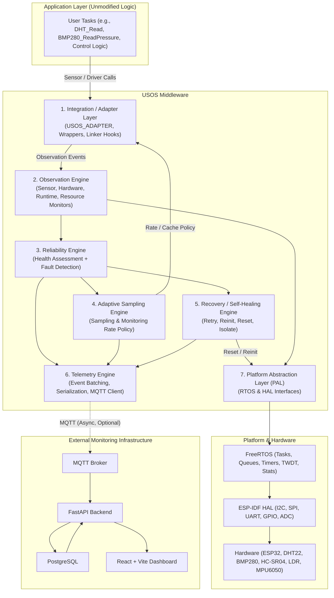
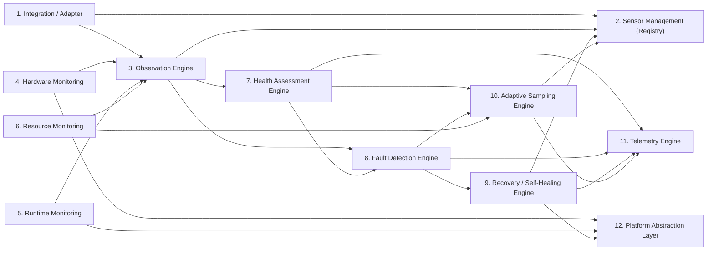
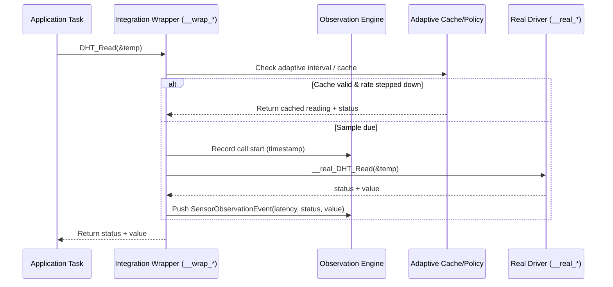
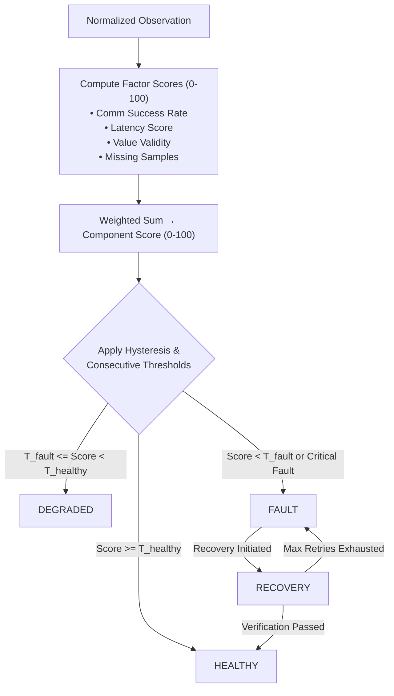
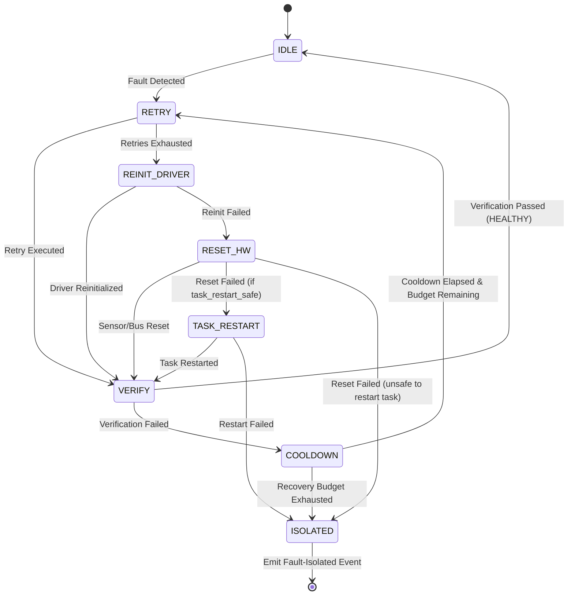
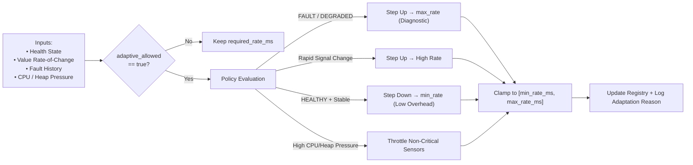
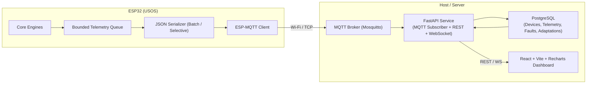

# System and Software Architecture Specification
## Universal Sensor Operating System (USOS)

**Document Version:** 1.0.0-draft  
**Status:** Proposed — Pending Review & Approval (Phase 4-1, Stage 1)  
**Primary Source of Truth:** [USOS Complete Project Design.md](file:///d:/Projects/College/USOS/USOS%20Complete%20Project%20Design.md) | [SRS.md](file:///d:/Projects/College/USOS/SRS.md)

---

## 1. Architectural Overview

USOS is a **layered, event-driven embedded reliability middleware** positioned between an existing FreeRTOS application and the underlying RTOS/HAL/Hardware stack. Its architecture separates **platform-independent reliability intelligence** (observation aggregation, health scoring, fault detection, adaptive policy, bounded recovery) from **platform-specific bindings** (ESP32 HAL, FreeRTOS runtime hooks, linker/wrapper integration, MQTT transport) and **external monitoring infrastructure** (MQTT broker, FastAPI, PostgreSQL, React dashboard).

---

## 2. Design Principles

1. **Declarative Integration Boundary:** The application developer describes the system once via `USOS_ADAPTER(...)`; USOS manages reliability internally.
2. **Core-Platform Separation:** Core reliability engines compile as pure C/C++ with zero direct calls to ESP-IDF or FreeRTOS APIs, enabling host-based unit testing.
3. **Static & Bounded Resource Usage:** Fixed-size arrays, ring buffers, and statically allocated FreeRTOS tasks/queues prevent heap fragmentation.
4. **Event-Driven over Polling:** Sensor read hooks and fault interrupts push lightweight events into USOS rather than polling all drivers continuously.
5. **Bounded Self-Healing:** Every recovery path has finite retries, cooldowns, and escalation limits.
6. **Autonomous Local Operation:** Network/dashboard unavailability never degrades local fault detection or recovery.

---

## 3. Overall System Architecture

---

## 4. Layered Architecture

| Layer | Responsibility | Portability |
| :--- | :--- | :--- |
| **Application Layer** | Existing user tasks and business/control logic. | User-owned |
| **USOS Integration Layer** | `usos.h`, `USOS_ADAPTER(...)`, driver wrappers, compile/link hooks. | Platform/build-coupled |
| **USOS Core Middleware** | Registry, Observation aggregation, Health, Fault, Adaptive, Recovery, Telemetry formatting. | **Platform-independent (C/C++)** |
| **Platform Abstraction Layer (PAL)** | Abstracts RTOS timing/tasks/memory and HAL bus/GPIO/reset primitives. | Interface is portable; impl is platform-specific |
| **FreeRTOS + HAL + Hardware** | Execution scheduler, peripheral drivers, physical MCU and sensors. | ESP32 / FreeRTOS |
| **External Infrastructure** | MQTT broker, FastAPI ingestion/API, PostgreSQL, React UI. | Host / Server |

---

## 5. Module Architecture (12 Core Modules)

To maintain strict modularity and traceability with the project design, USOS is structured into 12 well-bounded modules:

| # | Module | Primary Responsibility | Does NOT Do |
| :--- | :--- | :--- | :--- |
| 1 | **Integration / Adapter Layer** | Parses `USOS_ADAPTER` config, registers sensors/hooks, intercepts driver calls. | Execute recovery or compute health scores. |
| 2 | **Sensor Management Layer** | Maintains static sensor/component registry (state, rates, counts, timestamps). | Directly access hardware pins/buses. |
| 3 | **Observation Engine** | Collects, normalizes, and timestamps events from sensors, HW, runtime, and resources. | Classify faults or trigger resets. |
| 4 | **Hardware Monitoring** | Tracks I2C/SPI/UART errors, bus timeouts, GPIO/ADC status, and peripheral availability. | Manage FreeRTOS tasks. |
| 5 | **Runtime Monitoring** | Tracks FreeRTOS task states, CPU %, stack high-water marks, heap, TWDT events. | Interpret application logic. |
| 6 | **Resource Monitoring** | Tracks USOS's own RAM, CPU, queue depth, and active monitor count. | Modify application task priorities. |
| 7 | **Health Assessment Engine** | Computes `0–100` factor-weighted health scores and `HEALTHY/DEGRADED/FAULT/RECOVERY` states. | Execute hardware resets. |
| 8 | **Fault Detection Engine** | Applies deterministic/statistical rules to classify faults and log fault history. | Perform recovery actions directly. |
| 9 | **Recovery / Self-Healing Engine** | Executes bounded tiered recovery state machine and post-recovery verification. | Bypass retry/cooldown limits. |
| 10 | **Adaptive Sampling Engine** | Adjusts sampling/monitoring intervals within `min_rate`/`max_rate` constraints. | Override `adaptive_allowed == false`. |
| 11 | **Telemetry Engine** | Batches, serializes, and asynchronously publishes telemetry via MQTT. | Block local USOS loop on network failure. |
| 12 | **Platform Abstraction Layer (PAL)** | Provides uniform C interfaces for RTOS ticks, tasks, heap/stack, and HAL resets/buses. | Contain business or reliability policy. |

---

## 6. Integration / Adapter Architecture

### 6.1 Realistic Interception Strategy
Universal binary interception of arbitrary C/C++ functions is not technically feasible on embedded toolchains. USOS therefore uses a **tiered, build-integrated interception strategy** behind the single `USOS_ADAPTER(...)` boundary:

1. **Linker Function Wrapping (`-Wl,--wrap=<func>` in ESP-IDF/CMake) [Primary for C drivers]:**
   - The application calls `DHT_Read(&temp)` unchanged.
   - The linker redirects `DHT_Read` to `__wrap_DHT_Read`, which records entry timestamp, invokes `__real_DHT_Read`, records latency/return code/value, notifies the Observation Engine, and enforces adaptive caching/rate policies if configured.
2. **Driver Wrapper / Shim Binding [For C++ objects or header-only/inline drivers]:**
   - Where `--wrap` cannot intercept (e.g., C++ methods or `static inline` functions), `USOS_ADAPTER` binds a lightweight wrapper or macro shim at compile time.
3. **Driver Callbacks / HAL Hooks [For bus-level events]:**
   - I2C/SPI/UART error counters hook into ESP-IDF HAL return codes or bus wrappers.

---

## 7. Sensor Plugin Architecture

Each supported sensor type (DHT22, BMP280, HC-SR04, LDR, MPU6050) is described in the registry via a **Sensor Descriptor** (`usos_sensor_desc_t`) containing:
- Static identity (`id`, `name`, `type`, `bus_type`)
- Valid physical range (`min_val`, `max_val`, `max_roc` rate-of-change)
- Sampling constraints (`min_rate_ms`, `max_rate_ms`, `required_rate_ms`, `adaptive_allowed`)
- Optional lifecycle hooks (`reinit_fn`, `hw_reset_fn`, `gpio_power_pin`)

New sensors can be added as declarative descriptors without modifying the Health, Fault, Adaptive, or Recovery engines.

---

## 8. Hardware Abstraction (PAL)

The Platform Abstraction Layer (`platform/`) exposes two narrow interfaces:
- **`usos_pal_rtos.h`**: `get_tick_ms()`, `get_free_heap()`, `get_min_free_heap()`, `get_task_stats()`, `get_cpu_usage()`, `queue_send/recv()`, `mutex_lock/unlock()`.
- **`usos_pal_hw.h`**: `bus_reinit(bus_id)`, `gpio_pulse_reset(pin, ms)`, `adc_health_check()`, `watchdog_feed()`.

---

## 9. FreeRTOS Integration

- USOS runs a dedicated low-to-medium priority **USOS Supervisor Task** (`usos_task`, statically allocated) that processes observation events from a bounded FreeRTOS queue (`usos_obs_queue`).
- Application tasks are **not** blocked by USOS health/telemetry processing; driver wrappers perform O(1) non-blocking queue pushes (`xQueueSend(..., 0)`).
- FreeRTOS `configUSE_TRACE_FACILITY`, `configGENERATE_RUN_TIME_STATS`, and `INCLUDE_uxTaskGetStackHighWaterMark` are enabled via ESP-IDF `sdkconfig` defaults for runtime observation.

---

## 10. Observation Architecture

The Observation Engine aggregates four event streams into normalized `usos_obs_event_t` records:
1. **Sensor Stream:** Value, latency, return code, timeout flag, missed-sample count.
2. **Hardware Stream:** Bus NACK/timeout counts, peripheral busy/lockup flags.
3. **Runtime Stream:** Periodic snapshot of task states, stack high-water marks, free heap, CPU %, TWDT alerts.
4. **USOS Self-Resource Stream:** USOS queue high-water mark, USOS task CPU %, USOS static RAM footprint.

---

## 11. Health Assessment Architecture

- Both the **overall system health score** and **individual factor scores** are stored so the dashboard and logs explain *why* health dropped.

---

## 12. Fault Detection Architecture

The Fault Detection Engine evaluates incoming observations against deterministic rules:
- **Communication Fault:** `consecutive_errors >= N_err` or bus NACK/timeout.
- **Value Fault:** `NaN`, out of physical `[min_val, max_val]`, or stuck value (`variance == 0` over `K` samples when expected dynamic).
- **Timing Fault:** Driver latency `> timeout_ms` or missed expected sample window.
- **Runtime Fault:** Stack high-water mark `< stack_warn_bytes`, free heap `< heap_warn_bytes`, task starved, or TWDT trigger.

Detected faults are written to a fixed-size **Fault History Ring Buffer** and dispatched to the Recovery Engine.

---

## 13. Recovery Architecture

- **Recovery Budget:** Each component has `max_recovery_cycles` within a sliding window and `cooldown_ms` between escalations to guarantee no infinite recovery loops.

---

## 14. Adaptive Sampling Architecture

---

## 15. Resource Monitoring Architecture

USOS tracks its own overhead via the Resource Monitoring module:
- Static memory footprint (compile-time `sizeof` registry + buffers).
- `usos_obs_queue` and `usos_tel_queue` peak depth.
- `usos_task` CPU percentage and stack high-water mark.
- Telemetry packet count and bytes transmitted per interval.

---

## 16. Telemetry Architecture & 17. External Dashboard Architecture

- **Backpressure Policy:** If `usos_tel_queue` is full (e.g., Wi-Fi down), oldest non-critical periodic snapshots are dropped while critical fault/recovery events are prioritized in a reserved slot or ring buffer.

---

## 18. Internal Data Flow & 19. Event Flow

1. **Hot Path (Application Task):** Application calls sensor read → Integration wrapper captures timing/status → pushes small `usos_obs_event_t` (non-blocking) to `usos_obs_queue` → returns immediately.
2. **Middleware Path (USOS Task):** `usos_task` pops event → updates Sensor Registry → triggers Health Assessment → if abnormal, triggers Fault Detection → dispatches to Recovery Engine and Adaptive Engine → pushes compact event/snapshot to `usos_tel_queue`.
3. **Telemetry Path (MQTT Task):** `esp-mqtt` task asynchronously publishes queued payloads when connected.

---

## 20. Module Dependencies

- **Allowed Dependency Direction:** `Integration → Core Engines → PAL → FreeRTOS/HAL`.
- **Forbidden Dependencies:** Core Engines (`observation`, `reliability`, `adaptive`, `recovery`) must **never** include `freertos/*` or `driver/*` directly; all OS/HW access goes through `PAL`.

---

## 21. Memory Management Strategy

- **Static Allocation:** Sensor registry (`USOS_MAX_SENSORS`), fault ring buffer (`USOS_FAULT_HISTORY_SIZE`), observation queue, and USOS task TCB/stack are statically allocated at compile time.
- **Zero-Malloc Core:** Core reliability engines perform zero `malloc`/`free` calls during runtime operation.
- **Telemetry Buffers:** Fixed-size scratch buffer for JSON serialization.

---

## 22. Concurrency and Task Design

| Task / Context | Priority | Responsibility | Synchronization |
| :--- | :--- | :--- | :--- |
| **Application Tasks** | User-defined | Sensor reads & control logic | Non-blocking `xQueueSend(..., 0)` into USOS |
| **USOS Supervisor Task** | Low/Medium (below critical control) | Event processing, health, fault, recovery, adaptation | Owns registry; mutex only for shared wrapper cache |
| **Telemetry / MQTT Task** | Low | Wi-Fi/MQTT publishing | Consumes from `usos_tel_queue` |

---

## 23. Error Handling

- Internal USOS errors (e.g., queue full, invalid adapter config) increment internal diagnostic counters rather than crashing or halting the application.
- Invalid adapter configurations are caught via compile-time `static_assert`s wherever possible.

---

## 24. Security and Reliability Considerations

- **Dashboard/MQTT:** Support optional MQTT username/password and TLS configuration in `USOS_ADAPTER` for non-local deployments.
- **Watchdog Safety:** `usos_task` must never starve the idle task or hold bus mutexes indefinitely during recovery.

---

## 25. Architectural Limitations

1. Linker `--wrap` cannot intercept `static inline` functions or C++ virtual methods without explicit wrapper registration.
2. Adaptive sampling of application-driven loops requires either cached-read interception or USOS-managed timer/task polling.
3. Arbitrary FreeRTOS task restart is unsafe if the task holds dynamic memory or OS mutexes; hence task restart is strictly opt-in.

---

## 26. Open Architectural Decisions

1. **Primary Build Framework:** ESP-IDF vs. PlatformIO (evaluated in [ADR-001](file:///d:/Projects/College/USOS/docs/architecture/ADR-001-Build-Framework-and-Integration-Mechanism.md)).
2. **Exact `USOS_ADAPTER` Macro / Linker-Wrap Mechanics:** Finalize C/C++ macro syntax and CMake `--wrap` generation.
3. **Adaptive Sampling Control Mode:** Cached-return interception vs. driver-level schedule control when application code has hardcoded delays.
4. **Telemetry Payload Format:** Pure JSON vs. compact struct + backend decoding.
