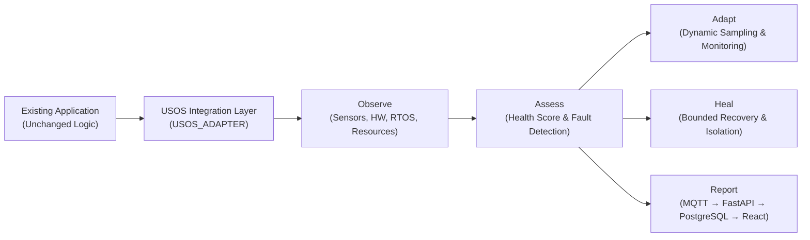

# USOS — Universal Sensor Operating System

**Lightweight Embedded Reliability Middleware for Adaptive Sensor, Hardware, and Runtime Management**

> **Project Status:** Phase 4-1, Stage 1 (Architecture & Specification). Implementation has not yet begun; all code examples below represent the target design.

---

## Overview

**USOS (Universal Sensor Operating System)** is a lightweight reliability middleware and monitoring framework designed to run underneath existing FreeRTOS embedded applications. It is **not** a replacement for an RTOS—instead, it adds an autonomous reliability layer that observes sensors, hardware buses, and FreeRTOS runtime health, detects faults, adapts sampling/monitoring rates, executes bounded self-healing, and streams telemetry to an external dashboard.

The central design philosophy is **minimal developer integration**:

> **USOS should improve the reliability and observability of an existing embedded system without requiring developers to rewrite their application.**

---

## Problem Being Addressed

As embedded applications grow in sensor count and RTOS task complexity, reliability code—communication retries, sensor resets, stack/heap checks, watchdogs, and remote logging—becomes fragmented and tightly coupled to business logic. At the same time, fixed sampling and monitoring rates waste CPU, bus bandwidth, and power when the system is stable, while failing to increase diagnostic visibility during faults.

---

## Proposed Solution

USOS introduces a modular C/C++ middleware layer executing a continuous **Observe → Assess → Decide → Act → Report** loop beneath unmodified application logic:



---

## Key Planned Features

- **Minimal Declarative Integration:** Single `#include <usos.h>` and `USOS_ADAPTER(...)` configuration without scattering `USOS_*` calls across application code.
- **Multi-Domain Observation:** Monitors sensor readings/latency, I2C/SPI/UART/GPIO hardware status, FreeRTOS task/stack/heap/CPU metrics, and USOS's own resource overhead.
- **Transparent Health Scoring:** Discrete states (`HEALTHY`, `DEGRADED`, `FAULT`, `RECOVERY`) backed by a `0–100` score and per-factor breakdown.
- **Bounded Self-Healing:** Tiered recovery (retry → driver reinit → sensor/peripheral reset → safe task restart → isolation) with strict retry limits and cooldowns.
- **Constraint-Safe Adaptive Sampling:** Dynamically scales sampling/monitoring within developer-defined `min_rate`, `max_rate`, and `required_rate` bounds.
- **Autonomous Local Operation:** Continues full local monitoring and recovery even when MQTT/dashboard connectivity is unavailable.
- **Full-Stack Observability:** Real-time and historical dashboard built with MQTT, FastAPI, PostgreSQL, and React + Vite.

---

## Technology Stack

| Layer | Technology |
| :--- | :--- |
| **Embedded MCU & RTOS** | ESP32, FreeRTOS, C/C++ |
| **Build & Simulation** | ESP-IDF (recommended) / PlatformIO, CMake, Wokwi |
| **Initial Sensors** | DHT22, BMP280, HC-SR04, LDR (ADC), MPU6050 (optional) |
| **Buses & Interfaces** | I2C, SPI, UART, GPIO, ADC |
| **Telemetry & Backend** | MQTT, FastAPI, PostgreSQL |
| **Frontend Dashboard** | React, Vite, Recharts / Chart.js |
| **Testing & Analysis** | Unity / CMock, Python (benchmarking) |

---

## Hardware & Software Requirements

- **Hardware (Target):** ESP32 development board, DHT22, BMP280, HC-SR04, LDR + resistor, optional MPU6050.
- **Simulation:** Wokwi ESP32 simulator for pre-hardware validation.
- **Software:** ESP-IDF toolchain (pending final selection in [ADR-001](file:///d:/Projects/College/USOS/docs/architecture/ADR-001-Build-Framework-and-Integration-Mechanism.md)), Python 3.10+, PostgreSQL, Node.js (for React/Vite dashboard), and an MQTT broker (e.g., Mosquitto).

---

## Repository Structure

```text
USOS/
├── USOS Complete Project Design.md   # Primary project concept & design baseline
├── SRS.md                            # Software Requirements Specification
├── Architecture.md                   # System & Software Architecture Specification
├── Roadmap.md                        # Milestone-based Development Roadmap
├── CONTRIBUTING.md                   # Contribution & engineering guidelines
├── .gitignore                        # Ignore rules (ESP-IDF, C++, Python, Node)
├── include/                          # Public headers (usos.h, USOS_ADAPTER) [Pending Stage 2]
├── src/                              # Platform-independent USOS core modules [Pending Stage 2+]
├── platform/                         # FreeRTOS & ESP32 PAL implementations [Pending Stage 2+]
├── examples/                         # Reference sensor applications [Pending Stage 2+]
├── tests/                            # Unity/CMock host unit tests & Wokwi scenarios [Pending Stage 2+]
├── dashboard/                        # FastAPI backend & React + Vite frontend [Pending Stage 7]
└── docs/
    ├── architecture/                 # Architecture Decision Records (ADRs)
    ├── design/                       # API & protocol specifications
    └── testing/                      # Test & evaluation strategy
```

---

## Development Status & Roadmap

USOS is currently in **Phase 4-1, Stage 1 (Architecture and Specification)**. No firmware or dashboard implementation code has been written yet.

- **Phase 4-1 — USOS Core Reliability Middleware:** Architecture → Integration Layer → Observation Engine → Health & Fault Engine → Recovery Engine → Adaptive Engine → Basic Telemetry & Dashboard.
- **Phase 4-2 — Intelligent USOS:** Advanced Adaptive Management → Advanced Reliability → Advanced Monitoring → Optional Intelligence (TinyML/Fusion) → Advanced Dashboard → Experimental Evaluation (Conventional vs. USOS).

See [Roadmap.md](file:///d:/Projects/College/USOS/Roadmap.md) for detailed stage deliverables, dependencies, and definitions of done.

---

## Installation and Setup

> **Pending:** Installation and build instructions will be added in **Phase 4-1, Stage 2** once the build framework (ESP-IDF vs. PlatformIO) is finalized and the initial middleware skeleton is implemented.

---

## Target Usage Example (Proposed Design)

The following illustrates the **intended** developer workflow once Stage 2 is implemented (exact macro syntax is specified in [API_Specification.md](file:///d:/Projects/College/USOS/docs/design/API_Specification.md)):

```cpp
#include <usos.h>

USOS_ADAPTER(
    .board = USOS_BOARD_ESP32,
    .sensors = {
        USOS_SENSOR_DHT22("dht_main", .pin = 4, .min_rate_ms = 2000, .max_rate_ms = 10000),
        USOS_SENSOR_BMP280("bmp_env", .i2c_addr = 0x76, .min_rate_ms = 500, .max_rate_ms = 5000)
    }
);

void app_main(void) {
    // Existing application logic remains unchanged
    while (1) {
        DHT_Read(&temperature);
        BMP280_ReadPressure(&pressure);
        vTaskDelay(pdMS_TO_TICKS(1000));
    }
}
```

---

## Documentation

- [Software Requirements Specification (SRS.md)](file:///d:/Projects/College/USOS/SRS.md)
- [System & Software Architecture (Architecture.md)](file:///d:/Projects/College/USOS/Architecture.md)
- [Development Roadmap (Roadmap.md)](file:///d:/Projects/College/USOS/Roadmap.md)
- [API & Adapter Specification (docs/design/API_Specification.md)](file:///d:/Projects/College/USOS/docs/design/API_Specification.md)
- [Test & Evaluation Strategy (docs/testing/Test_Strategy.md)](file:///d:/Projects/College/USOS/docs/testing/Test_Strategy.md)
- [ADR-001: Build Framework & Integration Mechanism](file:///d:/Projects/College/USOS/docs/architecture/ADR-001-Build-Framework-and-Integration-Mechanism.md)
- [ADR-002: Core Reliability & Telemetry Design](file:///d:/Projects/College/USOS/docs/architecture/ADR-002-Core-Reliability-and-Telemetry-Design.md)
- [Contributing Guidelines (CONTRIBUTING.md)](file:///d:/Projects/College/USOS/CONTRIBUTING.md)

---

## Future Development

Phase 4-2 explores cross-component fault correlation, sensor degradation trend analysis, and optional TinyML anomaly detection or sensor fusion—strictly after the core deterministic reliability middleware is validated.

---

## License

License selection is **TBD** (pending repository owner decision; MIT or Apache-2.0 recommended for open-source embedded middleware).
