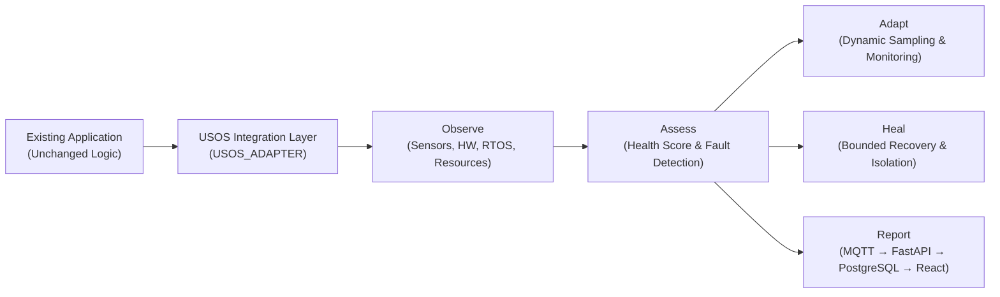

# USOS — Universal Sensor Operating System

**Lightweight Embedded Reliability Middleware for Adaptive Sensor, Hardware, and Runtime Management**

> **Academic Context & Status:** This is my **B.Tech 4th Year Major Project** in **Electronics and Communication Engineering (ECE)**, structured across two semesters in two phases:
> - **Phase 4-1 (4th Year, 1st Semester):** USOS Core Reliability Middleware *(Current — Stage 2 completed; Stage 3 ongoing)*
> - **Phase 4-2 (4th Year, 2nd Semester):** Intelligent USOS & Experimental Evaluation
>
> *Note: Implementation has not yet begun; all code examples below represent the frozen Stage 1 target design.*

---

## Overview

**USOS (Universal Sensor Operating System)** is a lightweight reliability middleware and monitoring framework designed to run underneath existing FreeRTOS embedded applications. It is **not** a replacement for an RTOS—instead, it adds an autonomous reliability layer that observes sensors, hardware buses, and FreeRTOS runtime health, detects faults, adapts sampling/monitoring rates, executes bounded self-healing, and streams telemetry to an external dashboard.

The central design philosophy is **minimal developer integration**:

> **USOS should improve the reliability and observability of an existing embedded system without requiring developers to rewrite their application.**

---

## Problem Being Addressed

As embedded applications grow in sensor count and RTOS task complexity, reliability code—communication retries, sensor resets, stack/heap checks, watchdogs, and remote logging—becomes fragmented and tightly coupled to business logic. At the same time, fixed sampling and monitoring rates waste CPU, bus bandwidth, and power when the system is stable, while failing to increase diagnostic visibility during faults.

---

## Proposed Solution

USOS introduces a modular C/C++ middleware layer executing a continuous **Observe → Assess → Decide → Act → Report** loop beneath unmodified application logic:



---

## Key Planned Features

- **Minimal Declarative Integration:** Single `#include <usos.h>` and `USOS_ADAPTER(...)` configuration without scattering `USOS_*` calls across application code.
- **Multi-Domain Observation:** Monitors sensor readings/latency, I2C/SPI/UART/GPIO hardware status, FreeRTOS task/stack/heap/CPU metrics, and USOS's own resource overhead.
- **Transparent Health Scoring:** Discrete states (`HEALTHY`, `DEGRADED`, `FAULT`, `RECOVERY`) backed by a `0–100` score and per-factor breakdown.
- **Bounded Self-Healing:** Tiered recovery (retry → driver reinit → sensor/peripheral reset → safe task restart → isolation) with strict retry limits and cooldowns.
- **Constraint-Safe Adaptive Sampling:** Dynamically scales sampling/monitoring within developer-defined `min_rate`, `max_rate`, and `required_rate` bounds.
- **Autonomous Local Operation:** Continues full local monitoring and recovery even when MQTT/dashboard connectivity is unavailable.
- **Full-Stack Observability:** Real-time and historical dashboard built with MQTT, FastAPI, PostgreSQL, and React + Vite.

---

## Technology Stack

| Layer | Technology |
| :--- | :--- |
| **Embedded MCU & RTOS** | ESP32, FreeRTOS, C/C++ |
| **Build & Simulation** | ESP-IDF (CMake), Wokwi |
| **Initial Sensors** | DHT22, BMP280, HC-SR04, LDR (ADC), MPU6050 (optional) |
| **Buses & Interfaces** | I2C, SPI, UART, GPIO, ADC |
| **Telemetry & Backend** | MQTT, FastAPI, PostgreSQL |
| **Frontend Dashboard** | React, Vite, Recharts / Chart.js |
| **Testing & Analysis** | Unity / CMock, Python (benchmarking) |

---

## Hardware & Software Requirements

- **Hardware (Target):** ESP32 development board, DHT22, BMP280, HC-SR04, LDR + resistor, optional MPU6050.
- **Simulation:** Wokwi ESP32 simulator for pre-hardware validation.
- **Software:** ESP-IDF toolchain with CMake (approved in [ADR-001](file:///d:/Projects/College/USOS/docs/architecture/ADR-001-Build-Framework-and-Integration-Mechanism.md)), Python 3.10+, PostgreSQL, Node.js (for React/Vite dashboard), and an MQTT broker (e.g., Mosquitto).

---

## Repository Structure

```text
USOS/
├── USOS Complete Project Design.md   # Primary project concept & design baseline
├── SRS.md                            # Software Requirements Specification
├── Architecture.md                   # System & Software Architecture Specification
├── Roadmap.md                        # Milestone-based Development Roadmap
├── CONTRIBUTING.md                   # Contribution & engineering guidelines
├── .gitignore                        # Ignore rules (ESP-IDF, C++, Python, Node)
├── include/                          # Public headers (usos.h, USOS_ADAPTER) [Pending Stage 2]
├── src/                              # Platform-independent USOS core modules [Pending Stage 2+]
├── platform/                         # FreeRTOS & ESP32 PAL implementations [Pending Stage 2+]
├── examples/                         # Reference sensor applications [Pending Stage 2+]
├── tests/                            # Unity/CMock host unit tests & Wokwi scenarios [Pending Stage 2+]
├── dashboard/                        # FastAPI backend & React + Vite frontend [Pending Stage 7]
└── docs/
    ├── architecture/                 # Architecture Decision Records (ADRs)
    ├── design/                       # API & protocol specifications
    └── testing/                      # Test & evaluation strategy
```

---

## Development Status & Roadmap

USOS has completed **Phase 4-1, Stage 1 (Architecture & Specification)** and **Stage 2 (Integration Layer — Linker Wrapping, Static Registry & PAL)**. **Stage 3 (Observation Engine)** is next; the dashboard and higher-level reliability engines are not yet implemented.

- **Phase 4-1 (4th Year, 1st Semester) — USOS Core Reliability Middleware:** Architecture → Integration Layer → Observation Engine → Health & Fault Engine → Recovery Engine → Adaptive Engine → Basic Telemetry & Dashboard.
- **Phase 4-2 (4th Year, 2nd Semester) — Intelligent USOS:** Advanced Adaptive Management → Advanced Reliability → Advanced Monitoring → Optional Intelligence (TinyML/Fusion) → Advanced Dashboard → Experimental Evaluation (Conventional vs. USOS).

See [Roadmap.md](file:///d:/Projects/College/USOS/Roadmap.md) for detailed stage deliverables, dependencies, and definitions of done.

---

## Installation and Setup

### 1. Prerequisites
- **ESP-IDF v5.x** (with CMake, Ninja, and `xtensa-esp32-elf-gcc`)
- **Wokwi Simulator** VS Code extension (optional, for virtual ESP32 testing) or a physical ESP32 board
- **Host C Compiler** (`gcc` + `cmake`, optional, for running host unit tests)

### 2. Build & Run ESP-IDF Examples (ESP-IDF PowerShell)
```powershell
git clone <repo-url>
cd USOS\examples\baseline_sensors
idf.py set-target esp32
idf.py build
```
- **In Wokwi:** Open [examples/baseline_sensors/diagram.json](file:///d:/Projects/College/USOS/examples/baseline_sensors/diagram.json) (or [examples/stage2_wrap_proof/diagram.json](file:///d:/Projects/College/USOS/examples/stage2_wrap_proof/diagram.json)) and click **Play** (`Wokwi: Start Simulator`).
- **On Physical ESP32:** Run `idf.py -p <PORT> flash monitor`.

### 3. Run Host Unit Tests
```powershell
cmake -S tests/unit -B tests/build
cmake --build tests/build
ctest --test-dir tests/build --output-on-failure
```

*(Dashboard setup instructions for FastAPI, PostgreSQL, and React + Vite will be added in Phase 4-1, Stage 7.)*

---

## Usage Example (Stage 2 Integration)

Integrate USOS into an existing ESP-IDF application using `#include <usos.h>`, `USOS_ADAPTER(...)`, and `usos_register_adapter()` in `main/CMakeLists.txt` (see [examples/baseline_sensors](file:///d:/Projects/College/USOS/examples/baseline_sensors/main/main.c)):

```c
#include <usos.h>

USOS_ADAPTER(
    .board = USOS_BOARD_ESP32,
    .device_id = "esp32-baseline-01",
    .sensors = {
        USOS_SENSOR_DHT22("dht_main", .address_or_pin = 4,
                          .min_rate_ms = 2000, .max_rate_ms = 10000,
                          .adaptive_allowed = true, .wrapped_symbol = "DHT_Read"),
        USOS_SENSOR_BMP280("bmp_env", .bus_port = 0, .address_or_pin = 0x76,
                           .min_rate_ms = 500, .max_rate_ms = 5000,
                           .adaptive_allowed = true, .wrapped_symbol = "BMP280_ReadPressure")
    }
);

void app_main(void) {
    // Existing application logic remains unchanged — zero USOS_* calls required
    while (1) {
        DHT_Read(&temperature);
        BMP280_ReadPressure(&pressure);
        vTaskDelay(pdMS_TO_TICKS(1000));
    }
}
```

---

## Documentation

- [Software Requirements Specification (SRS.md)](file:///d:/Projects/College/USOS/SRS.md)
- [System & Software Architecture (Architecture.md)](file:///d:/Projects/College/USOS/Architecture.md)
- [Development Roadmap (Roadmap.md)](file:///d:/Projects/College/USOS/Roadmap.md)
- [API & Adapter Specification (docs/design/API_Specification.md)](file:///d:/Projects/College/USOS/docs/design/API_Specification.md)
- [Test & Evaluation Strategy (docs/testing/Test_Strategy.md)](file:///d:/Projects/College/USOS/docs/testing/Test_Strategy.md)
- [ADR-001: Build Framework & Integration Mechanism](file:///d:/Projects/College/USOS/docs/architecture/ADR-001-Build-Framework-and-Integration-Mechanism.md)
- [ADR-002: Core Reliability & Telemetry Design](file:///d:/Projects/College/USOS/docs/architecture/ADR-002-Core-Reliability-and-Telemetry-Design.md)
- [Contributing Guidelines (CONTRIBUTING.md)](file:///d:/Projects/College/USOS/CONTRIBUTING.md)

---

## Future Development

Phase 4-2 explores cross-component fault correlation, sensor degradation trend analysis, and optional TinyML anomaly detection or sensor fusion—strictly after the core deterministic reliability middleware is validated.

---

## License

This project is licensed under the **MIT License** (see [STAGE_1_REVIEW.md](file:///d:/Projects/College/USOS/STAGE_1_REVIEW.md); `LICENSE` file to be added at Stage 2 initialization).
