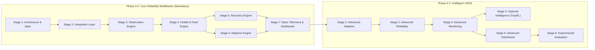

# USOS Development Roadmap

**Document Version:** 1.0.0  
**Status:** Frozen — Stage 1 Baseline  
**Primary Source of Truth:** [USOS Complete Project Design.md](file:///d:/Projects/College/USOS/USOS%20Complete%20Project%20Design.md)

---

## Overview

USOS is a **B.Tech 4th Year Major Project (ECE)** structured into two sequential phases across two semesters:
- **Phase 4-1 (4th Year, 1st Semester): USOS Core Reliability Middleware** — `[CORE / MANDATORY]`
- **Phase 4-2 (4th Year, 2nd Semester): Intelligent USOS** — Advanced reliability, analytics, experimental evaluation, and `[OPTIONAL]` intelligence.

Stages are ordered by technical dependency rather than arbitrary calendar deadlines.

---

## Phase 4-1: USOS Core Reliability Middleware `[CORE / MANDATORY]`

### Stage 1: Architecture and Specification `[FROZEN / COMPLETE]`
- **Objective:** Establish the complete engineering, architectural, and interface baseline before writing implementation code.
- **Tasks:**
  - Finalize `SRS.md`, `Architecture.md`, `Roadmap.md`, `API_Specification.md`, `Test_Strategy.md`, `STAGE_1_REVIEW.md`, and ADRs.
  - Resolve build framework choice (ESP-IDF with CMake) and `USOS_ADAPTER` interception strategy.
  - Define health, fault, recovery, adaptive (pass-through default), and telemetry data contracts.
- **Expected Deliverables:** Frozen documentation suite in root and `docs/`.
- **Dependencies:** None.
- **Validation Criteria:** Cross-document consistency check passed; all Stage 1 decisions signed off in `STAGE_1_REVIEW.md`.
- **Definition of Done:** All Stage 1 documents frozen with Stage 2 entry gates clearly defined.

### Stage 2: Integration Layer `[MANDATORY — NEXT]`
- **Objective:** Prove ESP-IDF linker wrapping (`--wrap=app_main` and `usos_register_adapter(WRAP_SYMBOLS ...)`) and implement `usos.h`, `USOS_ADAPTER(...)`, PAL skeleton, and driver interception hooks so an existing application compiles and runs with minimal changes.
- **Tasks:**
  - **Build Proof Gate:** Validate `-Wl,--wrap=app_main` redirection and `usos_register_adapter(WRAP_SYMBOLS ...)` linker propagation to the final ESP-IDF executable (1 wrapped C function + 1 unwrapped function + runtime test).
  - Implement `usos.h` and `USOS_ADAPTER` declarative configuration structures (with `cache_enabled = false` pass-through default).
  - Implement Sensor Management Layer (static registry).
  - Implement FreeRTOS PAL (`usos_pal_rtos`) and ESP32 HAL PAL (`usos_pal_hw`) stubs.
  - Implement linker `--wrap` and/or wrapper shims for DHT22, BMP280, HC-SR04, and LDR.
- **Expected Deliverables:** `include/usos.h`, `src/integration/`, `src/registry/`, `platform/esp32_freertos/`, and a minimal example in `examples/`.
- **Dependencies:** Phase 4-1 Stage 1.
- **Validation Criteria:** Existing baseline sensor application compiles and runs on Wokwi/ESP32 with zero application logic rewrites (`INT-001`, `INT-003`).
- **Definition of Done:** Host unit tests for registry/adapter config pass; example firmware builds and boots cleanly.

### Stage 3: Observation Engine `[MANDATORY]`
- **Objective:** Capture sensor, hardware, FreeRTOS runtime, and USOS self-resource observations with minimal overhead.
- **Tasks:**
  - Implement Observation Engine event queue and `usos_task`.
  - Implement Sensor Monitor (value, latency, status, timeouts, missed samples).
  - Implement Hardware Monitor (I2C/SPI/UART error counters, GPIO/ADC status).
  - Implement Runtime Monitor (task states, CPU %, stack high-water mark, free heap, TWDT).
  - Implement USOS Resource Monitor (queue peak, USOS task CPU/stack, static RAM).
- **Expected Deliverables:** `src/observation/` modules and Wokwi observation demo.
- **Dependencies:** Phase 4-1 Stage 2.
- **Validation Criteria:** All four observation streams produce accurate timestamped events under normal and fault-injected runs.
- **Definition of Done:** Unit tests pass on host; Wokwi run prints accurate sensor + FreeRTOS runtime metrics.

### Stage 4: Health and Fault Engine `[MANDATORY]`
- **Objective:** Convert raw observations into deterministic health states/scores and classified fault events.
- **Tasks:**
  - Implement Health Assessment Engine (`HEALTHY`, `DEGRADED`, `FAULT`, `RECOVERY`, `0–100` score + factor breakdown, hysteresis).
  - Implement Fault Detection Engine (comm failure, timeout, invalid/out-of-range/stuck value, bus error, stack/heap pressure, task starvation).
  - Implement bounded Fault History Ring Buffer.
- **Expected Deliverables:** `src/reliability/` modules and Unity unit test suite.
- **Dependencies:** Phase 4-1 Stage 3.
- **Validation Criteria:** Injected faults (NACK, disconnect, NaN, out-of-range, low heap) deterministically trigger expected fault classes and health transitions without flapping.
- **Definition of Done:** 100% pass on host unit tests for all fault classes and health hysteresis rules.

### Stage 5: Recovery Engine `[MANDATORY]`
- **Objective:** Execute bounded, tiered self-healing actions and post-recovery verification.
- **Tasks:**
  - Implement Recovery State Machine (`RETRY → REINIT_DRIVER → RESET_HW → TASK_RESTART (opt-in) → ISOLATED`).
  - Enforce `max_retries`, `cooldown_ms`, and sliding-window recovery budgets.
  - Implement post-recovery verification and safe-fallback/isolation notifications.
- **Expected Deliverables:** `src/recovery/` module and fault-recovery Wokwi + hardware test scenarios.
- **Dependencies:** Phase 4-1 Stage 4.
- **Validation Criteria:** Recoverable faults (transient I2C NACK, sensor timeout) recover and return to `HEALTHY`; permanent faults (disconnected sensor) hit retry limit and transition cleanly to `ISOLATED` without infinite loops.
- **Definition of Done:** Unit tests and Wokwi fault-injection tests verify bounded recovery for all supported fault classes.

### Stage 6: Adaptive Engine `[MANDATORY]`
- **Objective:** Dynamically adjust monitoring and sampling rates within adapter constraints to balance observability and resource overhead.
- **Tasks:**
  - Implement Adaptive Sampling Engine policy (rate-of-change, health state, fault history, CPU/heap pressure).
  - Enforce `min_rate_ms`, `max_rate_ms`, `required_rate_ms`, and `adaptive_allowed` boundaries.
  - Integrate adaptive cache/interval control into Integration wrappers and Observation scheduling.
- **Expected Deliverables:** `src/adaptive/` module and adaptation trace tests.
- **Dependencies:** Phase 4-1 Stage 4.
- **Validation Criteria:** Sampling/monitoring interval increases toward `max_rate_ms` during stable operation, decreases toward `min_rate_ms` during rapid change/degraded health, enters diagnostic sampling mode on suspected fault, and never violates `adaptive_allowed == false` (`required_rate_ms`).
- **Definition of Done:** Unit tests and Wokwi runs demonstrate measurable transaction reduction in stable state and diagnostic step-up during faults.

### Stage 7: Basic Telemetry and Dashboard `[MANDATORY]`
- **Objective:** Provide end-to-end visibility from ESP32 to the React dashboard while preserving autonomous local operation.
- **Tasks:**
  - Implement Telemetry Engine (bounded queue, JSON batching, MQTT client with non-blocking backpressure).
  - Implement FastAPI MQTT subscriber, PostgreSQL schema, and REST/WebSocket API.
  - Implement React + Vite dashboard (System Overview, Sensor Monitoring, Runtime Monitoring, Fault/Recovery & Adaptive views).
  - Measure baseline Phase 4-1 performance metrics (`PRF-001`–`PRF-006`).
- **Expected Deliverables:** `src/telemetry/`, `dashboard/backend/`, `dashboard/frontend/`, and initial benchmark report.
- **Dependencies:** Phase 4-1 Stages 5 and 6.
- **Validation Criteria:** Live ESP32 telemetry renders on React UI; disconnecting MQTT/Wi-Fi does not interrupt local USOS recovery.
- **Definition of Done:** End-to-end Phase 4-1 acceptance criteria (`SRS.md` Section 25) verified.

---

## Phase 4-2: Intelligent USOS

### Stage 1: Advanced Adaptive Management `[MANDATORY]`
- **Objective:** Refine adaptive policies with sensor prioritization, resource-aware throttling, and adaptive diagnostic scheduling.
- **Tasks:** Priority-weighted throttling under CPU/RAM pressure; hysteresis tuning for rate transitions.
- **Expected Deliverables:** Updated `src/adaptive/` policies and unit tests.
- **Dependencies:** Phase 4-1 Stage 7.
- **Validation Criteria:** High-priority sensors retain target rates while low-priority sensors throttle under simulated CPU load.
- **Definition of Done:** Policy tests pass and show improved CPU stability under load.

### Stage 2: Advanced Reliability `[MANDATORY]`
- **Objective:** Add degradation trend detection, component reliability scoring, and cross-component fault correlation.
- **Tasks:** Implement bus-level correlation (e.g., multiple I2C sensors failing → I2C bus fault) and sliding-window degradation scoring.
- **Expected Deliverables:** Enhanced `src/reliability/` correlation & trend modules.
- **Dependencies:** Phase 4-2 Stage 1.
- **Validation Criteria:** Simulated shared-bus failure is attributed to the bus rather than isolating each sensor independently.
- **Definition of Done:** Correlation unit & Wokwi tests pass.

### Stage 3: Advanced Monitoring `[MANDATORY]`
- **Objective:** Enable long-term reliability metrics, runtime trend analysis, and fault clustering in the backend.
- **Tasks:** PostgreSQL aggregation queries and FastAPI endpoints for historical health/fault/resource trends.
- **Expected Deliverables:** Backend analytics endpoints and database migrations.
- **Dependencies:** Phase 4-2 Stage 2.
- **Validation Criteria:** Historical queries return accurate MTBF/recovery-rate metrics over multi-hour test runs.
- **Definition of Done:** Backend integration tests pass.

### Stage 4: Optional Intelligence `[OPTIONAL / RESEARCH]`
- **Objective:** Evaluate lightweight ML/statistical extensions *only* after core USOS is stable.
- **Tasks:** Prototype TinyML (TensorFlow Lite Micro / scikit-learn exported model) anomaly detection or sensor fusion on ESP32.
- **Expected Deliverables:** Optional compile-time flag `USOS_ENABLE_TINYML` and overhead comparison.
- **Dependencies:** Phase 4-2 Stage 3.
- **Validation Criteria:** Core USOS remains 100% functional with feature disabled; overhead of optional ML is quantified.
- **Definition of Done:** Feature is cleanly isolated behind compile-time flag; core project remains complete regardless of inclusion.

### Stage 5: Advanced Dashboard `[MANDATORY]`
- **Objective:** Expose historical analytics, recovery success rates, adaptation reasons, and estimated resource savings in the UI.
- **Tasks:** Add trend charts (Recharts/Chart.js) and comparative resource-savings panels to React dashboard.
- **Expected Deliverables:** Updated `dashboard/frontend/` views.
- **Dependencies:** Phase 4-2 Stage 3.
- **Validation Criteria:** All Phase 4-2 Stage 5 dashboard views render live and historical data accurately.
- **Definition of Done:** UI verification checklist passes.

### Stage 6: Experimental Evaluation `[MANDATORY / RESEARCH]`
- **Objective:** Quantitatively evaluate USOS against a Conventional Fixed-Rate Embedded System.
- **Tasks:**
  - Build identical sensor application in two variants: Conventional vs. USOS-integrated.
  - Execute Python benchmarking & analysis scripts across: Integration effort (LOC changed), Resource overhead (RAM, Flash, CPU), Reliability (detection latency, recovery time, success rate, false positives), Adaptation (sampling/CPU/comm savings), and Scalability (1 to N sensors).
- **Expected Deliverables:** Evaluation dataset, Python analysis scripts, and final benchmark report populating all `TBD` targets in `SRS.md`.
- **Dependencies:** Phase 4-2 Stage 5.
- **Validation Criteria:** Reproducible benchmark runs comparing Conventional vs. USOS on physical ESP32 hardware.
- **Definition of Done:** Complete empirical results documented with clear trade-off analysis.
